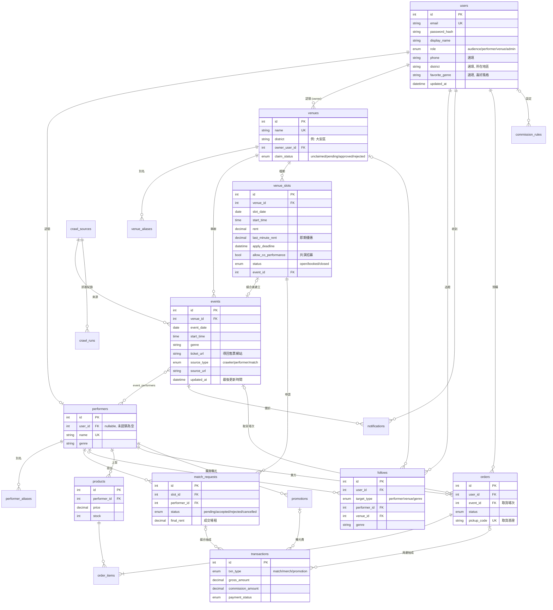

# Gig Radar 演出雷達｜ERD

由期中報告的 DFD 七個資料儲存（D1–D7）展開成 19 張資料表。
完整欄位定義以 `src/main/java/tw/gigradar/model/` 為準，`db/schema.sql` 由 `.\mvnw spring-boot:run "-Dspring-boot.run.arguments=export-schema"` 自動產生。

## 資料儲存 → 資料表對照

| DFD 資料儲存 | 資料表 | 對應處理程序 |
|---|---|---|
| D1 會員資料 | `users`、`performers`、`performer_aliases`、`venues`、`venue_aliases` | 全部；場館認領由管理者審核 |
| D2 演出資訊 | `events`、`event_performers`、`crawl_sources`、`crawl_runs` | 1.1–1.3 寫入、2.1 查詢、3.5 建立 |
| D3 場地檔期 | `venue_slots` | 3.1 上架空檔、3.2 查詢、3.4 更新狀態 |
| D4 媒合紀錄 | `match_requests` | 3.3 受理、3.4 確認、5.1 讀取成交場租 |
| D5 追蹤清單 | `follows`、`notifications` | 2.2 設定追蹤、2.3 發送通知 |
| D6 商品與訂單 | `products`、`orders`、`order_items` | 4.1–4.3、5.1 讀取訂單金額 |
| D7 交易紀錄 | `transactions`、`commission_rules`、`promotions` | 5.1–5.4 |

## ERD

## 幾個設計決定（報告時可以講）

1. **演出去重**：`events` 上有 `UNIQUE(venue_id, event_date, start_time)`，對應提案書「日期＋場館＋開演時間」規則。爬蟲沒抓到開演時間時，MySQL 的 UNIQUE 不會擋 NULL，所以 `DedupService.findDuplicateEvent()` 在程式裡再比一次。
2. **別名表**：`performer_aliases` 與 `venue_aliases` 處理「樂團名稱不一致」與「場館名稱對應」兩個爬蟲難點。
3. **場館兩階段**：爬蟲先建立 `claim_status = unclaimed` 的場館；場地方認領後經管理者審核變成 `approved`，才能管理 `venue_slots`。
4. **共演**：不另開資料表，`venue_slots.allow_co_performance` + `max_performers` 允許多組表演者申請同一空檔，成交場租平分寫在各自的 `match_requests.final_rent`。
5. **抽成規則有歷史**：`commission_rules` 以 `effective_from` 保存每次調整，交易時把當下的比例存進 `transactions.commission_rate`，日後改規則不影響舊帳。
6. **範疇外**：`orders.fulfillment` 保留 `shipping` 值，但宅配物流流程不實作；金流以 `transactions.payment_ref` 模擬。
7. **登入與帳號**：四種角色共用 `users` 一張表，以 `role` 區分權限（Spring Security：`/api/admin/**` 限管理者、`/api/me/**` 需登入）。密碼只存 PBKDF2 雜湊；email 一律存小寫，登入不分大小寫。登入狀態存在伺服器 Session，「我的追蹤 / 通知」一律依登入者查詢，不從網址傳 user_id，避免看到別人的資料。
